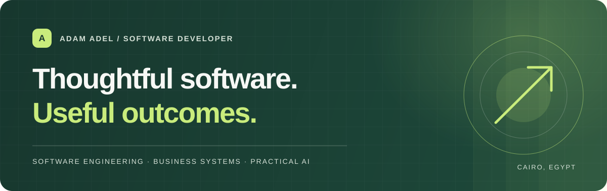
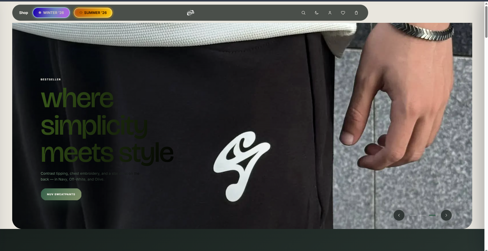
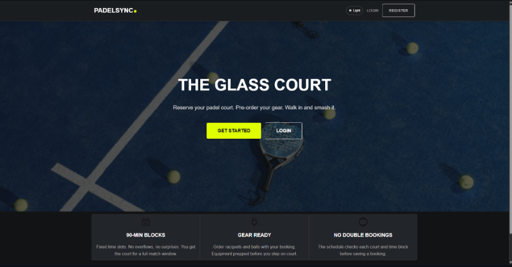
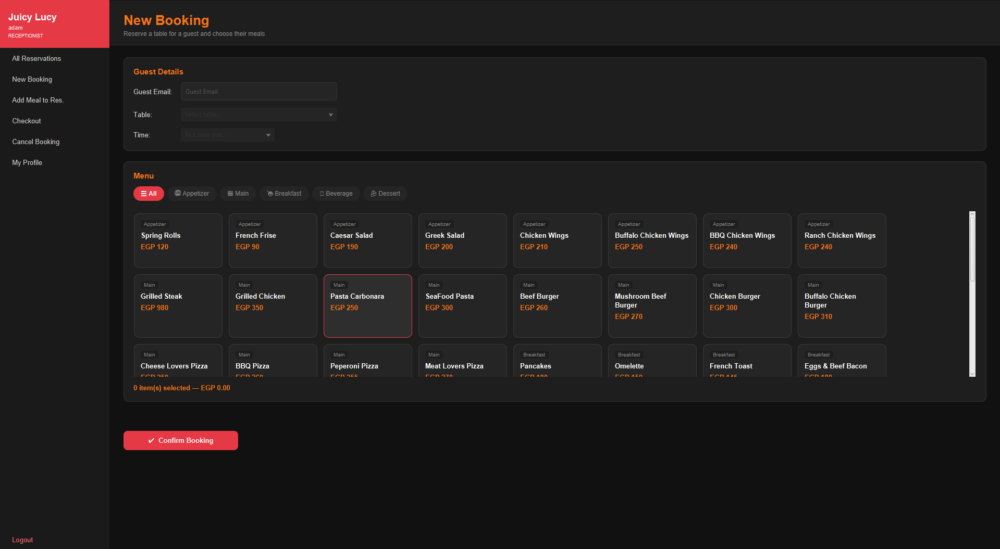
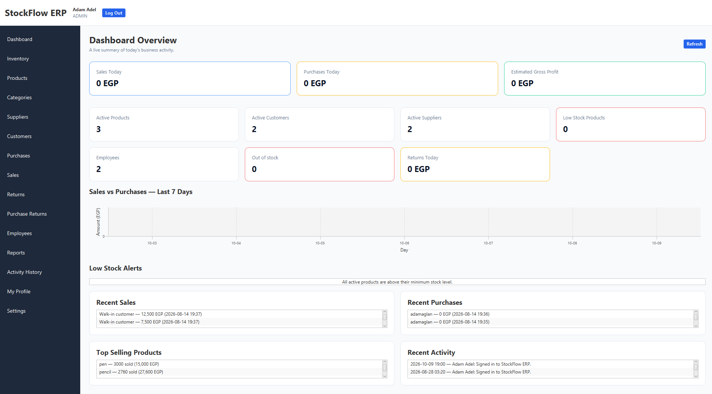

<div align="center">
  

  <p><strong>Personal portfolio · Cairo, Egypt</strong></p>
  <p>Software engineering · Business systems · Practical AI</p>

  <p>
    <a href="#selected-work">Selected work</a> ·
    <a href="#about-the-site">About the site</a> ·
    <a href="#run-locally">Run locally</a>
  </p>

  <p>
    
    
    
    
  </p>
</div>

## Selected work

This portfolio brings together individual builds, a university team project, and an independent venture. The galleries use locally stored project screenshots so they remain part of the site when the repository is deployed.

<table>
  <tr>
    <td width="50%" valign="top">
      
      <h3>Nuvanti</h3>
      <p>An e-commerce experience for a clothing brand, with storefront and supporting commerce tools.</p>
      <p><strong>Stack:</strong> JavaScript · Node.js · Express · PostgreSQL · Railway · Cloudflare · Supabase</p>
      <p><a href="https://nuvanti-shop.pages.dev/">Visit the Nuvanti site ↗</a></p>
    </td>
    <td width="50%" valign="top">
      
      <h3>PadelSync</h3>
      <p>A court reservation and scheduling platform built as a four-student MIU SWE230 team project.</p>
      <p><strong>Stack:</strong> JavaScript · Node.js · Express · MongoDB · Mongoose · Railway</p>
    </td>
  </tr>
  <tr>
    <td width="50%" valign="top">
      
      <h3>Restaurant Management System</h3>
      <p>A Java application with database-backed workflows for menu items, tables, reservations, and orders.</p>
      <p><strong>Stack:</strong> Java · Database</p>
    </td>
    <td width="50%" valign="top">
      
      <h3>Inventory Management System</h3>
      <p>A stock and sales system covering products, inventory, purchasing, returns, employees, and reports. <strong>Still in development; I’m actively working on it.</strong></p>
      <p><strong>Stack:</strong> Java · PostgreSQL</p>
    </td>
  </tr>
</table>

## About the site

The portfolio is built with semantic HTML, responsive CSS, and vanilla JavaScript. It has no framework, package manifest, or compilation step. Project information and gallery images are rendered from the `projects` array in [`script.js`](script.js).

### Highlights

- Responsive layout and mobile navigation
- Project galleries with expandable screenshot collections
- Case-study sections for project challenges, approaches, and contributions
- Reduced-motion support and keyboard-visible focus styles
- Local project images; only web fonts and badge graphics load from external hosts

## Run locally

From the project folder, run:

```sh
npx serve .
```

You can also open `index.html` directly in a browser. A local server gives the most reliable behavior for root-relative asset paths.

## Deploy

This static site can be deployed to Cloudflare Pages without a build command:

1. Connect the repository to a Cloudflare Pages project.
2. Choose the **None** framework preset.
3. Leave the build command blank and set the build output directory to `/`.

Or deploy from the command line with Wrangler:

```sh
npx wrangler pages deploy . --project-name adam-adel-portfolio
```

## Update the content

- **Projects and technologies:** edit the `projects` array near the top of [`script.js`](script.js).
- **Project screenshots:** add images under `assets/projects/` and list their paths, alt text, and captions in that project’s `screenshots` array.
- **Social links:** add verified profile URLs to the `socialProfiles` object in [`script.js`](script.js); empty values stay hidden.
- **Visual style:** edit [`styles.css`](styles.css).

## Ownership

© 2026 Adam Adel. All rights reserved. This repository does not include an open-source license. Public visibility still allows people to view and fork the source through GitHub. If you want to restrict access to the code, make the repository private; the deployed portfolio can remain public.

---

<div align="center">
  <sub>Designed and built by <a href="https://github.com/adam3glann">Adam Adel</a> · <a href="https://arqevin-fxw.pages.dev/">ARQEVIN</a></sub>
</div>
